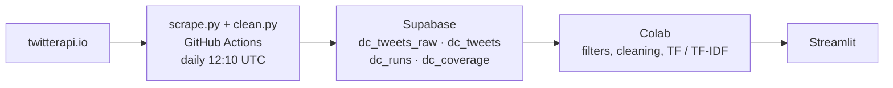

# Sentiment analysis — data centers in Argentina

GitHub Actions **collects** tweets and stores them in Supabase. Filtering, cleaning, and TF/TF-IDF happen in the owner's Colab notebook, which is not in this repository. The [Streamlit app](https://github.com/ftm2-rice/Streamlit_visual_sentiment_analysis_dc) shows the snapshot produced after that notebook.

## Pipeline



Colab reads `dc_tweets_raw` and applies bot, short-text, off-topic, and duplicate-text filters. This repo does not. `dc_tweets` is the scraper-kept mirror (raw minus retweets) that the daily job maintains.

## Files

| file | role |
|---|---|
| `config.py` | Search strings, outlets, time windows, caps, table names. Edit this, not the fetch loop. |
| `gates.py` | Collection gates and row building: drop retweets, decide which threads to expand, label `source_type`. |
| `scrape.py` | Calls twitterapi.io and writes Supabase. Run by the daily workflow. |
| `clean.py` | Mirrors scraper-kept rows from `dc_tweets_raw` into `dc_tweets`. No analysis. |
| `.github/workflows/scrape.yml` | Cron `10 12 * * *` (12:10 UTC). Runs `scrape.py`, then `clean.py`. |
| `sql/001_dc_tweets_raw.sql` | One-off migration for the raw table. Run in the Supabase SQL editor. |
| `tests/test_scrape_gates.py` | Collection gates and the mirror. No API and no Supabase. |

## Run

```
python scrape.py --mode daily            # last 48 h + history until 1,000 stored rows
python scrape.py --mode test --dry-run --csv out/test.csv   # ≈ $0.015, writes a raw CSV only
python clean.py                          # mirror dc_tweets_raw → dc_tweets
python clean.py --csv raw.csv --dry-run  # mirror count only, no Supabase
```

Env vars: `TWITTERAPI_IO_KEY`, `SUPABASE_URL`, `SUPABASE_SERVICE_KEY` (GitHub Actions secrets).
Never commit credentials to this repository.

## Tables

| table | what | written by |
|---|---|---|
| `dc_tweets_raw` | every tweet fetched; `drop_reason` NULL means the scraper kept it | scrape.py, clean.py |
| `dc_tweets` | scraper-kept rows (raw minus retweets) | scrape.py, clean.py |
| `dc_runs` | one row per run: fetched, inserted, cost | scrape.py |
| `dc_coverage` | ISO-week × query cells already swept | scrape.py |

The scraper writes `drop_reason` NULL, `retweet`, or `over_target`. Older rows may still say `bot`, `short`, `offtopic`, or `dup_text`. `clean.py` leaves those labels as stored and does not copy them into `dc_tweets`.

## What the collector spends money on

The query is `CORE_TERMS` plus an Argentina anchor, with `-filter:nativeretweets`. Ids already in `dc_tweets` are skipped. `is_on_topic` only chooses which outlet posts are expanded into threads. The daily cron uses a 48-hour fresh window, then walks historical ISO weeks, skipping cells already in `dc_coverage`, until 1,000 new stored rows or the hard cap. `BUDGET_USD` refuses to start a run once past spend reaches the cap.
